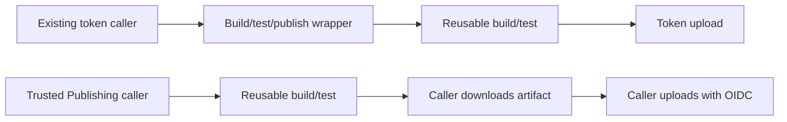
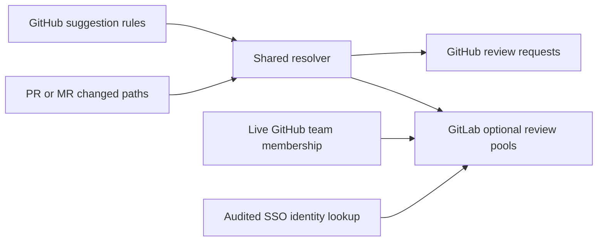

# NeMo-FW-CI-templates

A repository to centrally manage workflows across the NeMo-FW library landscape.

## Wheel builds and Trusted Publishing

`_build_test_wheel.yml` builds, installs, and validates distributions without
publishing. Its outputs are `version`, `pypi-name`, and `artifact-name`.
The artifact retains the name `pip-wheel-<run-id>-<python-package>`.
Build jobs request `contents: read`; the optional `GH_TOKEN` secret is only for
builds that need private dependencies.

`_build_test_publish_wheel.yml` retains its existing inputs, defaults, secrets,
version/name outputs, environments, token authentication, and `no-publish`
behavior. It delegates artifact production to `_build_test_wheel.yml` and only
uploads after that workflow succeeds. The optional `repository-url` input
defaults to `https://upload.pypi.org/legacy/`; callers can explicitly select
`https://test.pypi.org/legacy/` with a TestPyPI token. `_release_library.yml`
callers require no changes.

For Trusted Publishing, the consuming repository will call the build-only
workflow and download its artifact in a separate job in its top-level release
workflow. That job will use `pypa/gh-action-pypi-publish` with `id-token: write`
and a registered GitHub environment. Do not put the OIDC upload inside a
reusable workflow. See the [PyPA action documentation](https://github.com/pypa/gh-action-pypi-publish#trusted-publishing).



The wheel smoke workflow builds a fixture through both entry points without
publishing, then compares their outputs. `tests/test_wheel_workflows.py` checks
the existing call contract and executes the legacy upload script with a local
command recorder, including dry-run, missing-token, and TestPyPI cases.

## Shared review suggestions

`codeowners_suggestions.py` resolves advisory `# suggest:` entries from a trusted
GitHub `.github/CODEOWNERS`. GitHub and GitLab use the same parser, micromatch
engine, last-match precedence, and per-file suppression of enforced duplicates.
The engine retains the GitHub workflow's `all_changed_files` behavior: renamed
files use their new paths, and deleted files are excluded. An enforced owner is
not automatically turned into a GitLab review suggestion.



The GitLab adapter creates named MR approval rules with `approvals_required: 0`.
These rules expose review pools without requiring approvals or assigning every
member as an individual reviewer. The CI-Events `gym-review-router` owns GitLab
reviewer assignment, so this adapter never writes the MR Reviewers field.
Team membership comes from GitHub on each run;
no mirrored GitLab groups or second path map are needed.

GitLab switches to MR-local approval rules when the first pool is created.
Future project-level regular or any-approver rules will not automatically apply
to those MRs. Consumers must accept this limitation and migrate existing MRs when
introducing or changing project approval requirements. The adapter refuses to
create pools when that switch would discard an existing required project rule;
it checks effective approval state during planning and again before each create.
Existing MR-local required rules and native CODEOWNERS remain intact.

Identity resolution reuses `check-nvidia-sso/download_sso.py` and its audited
GitHub-login to corporate-email roster. The adapter searches GitLab and requires
a single candidate whose user details expose an exactly matching primary or
public email, then verifies active Developer-or-higher project membership.
A generic search hit alone is insufficient; if neither email is visible, use a
verified identity map or the explicit site convention below. On NVIDIA's
GitLab, use `--gitlab-username-from-email`: GitLab accounts use the audited
corporate email's account name, while private emails are not searchable. This
mode queries the exact GitLab username and still validates project membership.
It never derives an internal account name from the GitHub handle.

Provide the read-only audit credential as `GH_SSO_MANAGMENT_PAT`. The spelling
matches the existing credential. It is passed only to the downloader subprocess;
normal GitHub API calls continue to use the `gh` credentials. The temporary roster
is deleted when the download has been read.

For environments with an existing verified account map, `--identity-map` accepts
a JSON object instead of downloading the roster:

```json
{"github-login": "gitlab-username"}
```

Keep any explicit identity maps in trusted internal configuration. Missing mappings
and empty review pools stop the adapter before writes. Inactive accounts, missing
project members, and accounts below Developer access are skipped with warnings
in the JSON plan. Eligible members still populate each pool. The MR author is excluded. The adapter manages only
optional rules named `github-review-pool: @organization/team` (or `@user`),
reconciles membership, and removes stale pools with that prefix. It refuses to
modify a matching rule if someone makes it required.

Requirements: Python 3.12+, Node.js 20+, npm, and authenticated `gh` and `glab`.
The GitHub identity needs repository-content and team-membership read access;
the GitLab identity needs project-member read access and MR approval-rule write
access for apply mode. There is no need for GitHub write access in this adapter.

Run from a trusted checkout of FW-CI-templates:

```sh
npm ci --prefix .github/scripts/review-matcher --ignore-scripts --no-audit --no-fund
python3 .github/scripts/gitlab_review_pools.py \
  --gitlab-host "$GITLAB_HOST" --project "$GITLAB_PROJECT_ID" \
  --mr "$MR_IID" --target-branch "$REVIEW_TARGET_BRANCH" \
  --github-repository "$GITHUB_REPOSITORY" --github-ref main
```

This command only reads APIs and prints a plan with the MR head, immutable GitHub
rules revision, proposed mutations, and mapping problems. Add `--apply` to write
the optional pools. Apply rechecks the MR head and target before each mutation
and verifies convergence afterward. API failures can leave a partially applied
set of optional pools; rerunning reconciles them. GitLab does not provide an
atomic conditional update of MR approval rules, so concurrent pushes can require
another reconciliation.

For a project webhook that triggers a fixed protected branch, replace `--mr`
with `--event-file "$TRIGGER_PAYLOAD"`. The adapter accepts only ready, open MRs
in the configured target project and branch, on `open`, `reopen`, or `update`
events. Approval notifications and unrelated events are skipped before any API
or credential lookup. The MR is reread from the API so delayed webhook delivery
uses the current diff rather than the event's previous commit.

The webhook URL has the form
`https://gitlab.example.com/api/v4/projects/123/ref/internal/trigger/pipeline?token=<trigger-token>`.
Keep the URL and trigger token in GitLab's project settings, not in repository
files. The consumer's CI rules must accept only trigger pipelines on its fixed
protected branch, with the `review-pools` environment and a serial resource
group. This pipeline executes trusted branch code and the pinned templates
revision; it never checks out the MR source branch.

For automation, invoke the adapter from trusted infrastructure on MR creation,
updates, and transition out of draft, serializing runs per MR. Pin the tool checkout
to a reviewed commit and keep credentials outside the MR checkout. For GitLab CI,
use protected, masked, hidden variables scoped to the trusted job's environment.
Protect that environment for the dedicated trigger owner as well: variable
protection alone permits other protected branches to consume the credentials
if their jobs declare the same environment. Ordinary feature-branch MR jobs
cannot consume a protected variable.
Draft and closed MRs are skipped. The adapter is advisory; its failure
must not become a required CI check. This repository does not install an MR event
trigger or enable this adapter on consumer projects.

Validate locally with:

```sh
python3 -m unittest discover -s .github/scripts -p 'test_codeowners_suggestions.py'
python3 -m unittest discover -s .github/scripts -p 'test_review_suggestions.py'
actionlint .github/workflows/_suggest_reviewers.yml .github/workflows/pre-flight.yml
```

## Guardwords checks

The reusable `_guardwords_check.yml` workflow scans added diff lines and optionally
fetches the PR description using its `pr-number` input. For catalog access, pass
a read-only deploy key registered on `NVIDIA-NeMo/Guardwords` as the
`GUARDWORDS_DEPLOY_KEY` secret. Callers using GitHub App authentication can
supply the `bot-app-id` input and `BOT_KEY` secret. The deploy key takes
precedence when both are supplied.

Pass the PR number from the same verified metadata used to validate the mirror
commit. For mirror-push callers, expose the number from the PR metadata job:

```yaml
outputs:
  pr-number: ${{ fromJSON(steps.pr.outputs.pr-info).number }}
```

Then add this input to the reusable workflow call alongside its existing inputs:

```yaml
pr-number: ${{ fromJSON(needs.pr_info.outputs.pr-number) }}
```

Callers of this workflow revision must allow these read-only token permissions:

```yaml
permissions:
  contents: read
  pull-requests: read
```

The workflow fetches the description directly into a temporary file in the runner.
It verifies the PR number, base repository, and head SHA before writing the body,
and fails with a generic message if the fetch or verification fails. Raw description
text is never a workflow input, step environment value, output, or printed message.
Description matches report only `PR description:<line>`. The entire fetched body is
scanned, including Markdown and code blocks.

Omitting `pr-number` (or passing zero) preserves diff-only checking and makes no PR
API request. This does not change the local pre-commit hook, which scans staged
additions and skips when the private catalog is unavailable.

A description edit does not trigger a mirror-push workflow by itself. Rerun the
caller to fetch and check the current description.

Validate locally with:

```sh
python3 -m unittest discover -s .github/scripts -p 'test_guardwords.py'
python3 -m unittest discover -s .github/scripts -p 'test_fetch_pr_description.py'
```

## Code freeze authentication

Pass `app-id: ${{ vars.BOT_ID }}` and the `BOT_KEY` secret to `_code_freeze.yml`.
The caller supplies its own App identity: `NVIDIA/Megatron-LM` uses App `3610216`
(`nvidia-megatron-lm-release-bot`); NVIDIA-NeMo repositories use App `1605575`
(`nemo-automation-bot`). The shared workflow does not choose an App by owner.

Each write job mints a separate token scoped to the calling repository, with
`contents:write`. The version-bump job also requests `pull_requests:write` for its
PR. Release-branch creation also requests `administration:write` for the existing
protected-branch admin access.
Both Apps already grant these permissions. Validate branch protection before a
release; App authentication does not change the repository's protection rules.

Set `environment-name` to preserve the caller's release-branch job environment
(usually `main`, or `public` for callers that previously omitted `use-pat`).
The notification job retains its existing dry-run environment and behavior.

The legacy `use-pat` / `PAT` interface remains available during migration. Once
either `app-id` or `BOT_KEY` is supplied, both credentials and a successfully
minted token are required; the workflow fails instead of selecting legacy
credentials. The version-bump PR receives an explicit App token. Its checkout
does not persist credentials, avoiding duplicate Authorization headers.

Validate locally with:

```sh
python3 -m unittest discover -s .github/scripts -p 'test_code_freeze.py'
actionlint .github/workflows/_code_freeze.yml .github/workflows/pre-flight.yml
```

The shell integration tests require PyYAML 6.0.3. They use disposable local Git
repositories and synthetic tokens to cover rejected partial App configuration,
legacy authentication, dry-run branch pushes, and setuptools/hatch version bumps.

## CI failure notifications

Use [Notify CI failure](.github/actions/notify-ci-failure/README.md) in a final
workflow job to summarize failed dependencies in Slack. Each repository owns its
schedule/dispatch/branch policy and webhook; the shared action handles bounded
message formatting and reuses the existing Slack sender.

## Test approval queues

`_test_approval_queue.yml` classifies the pull-request author, not the workflow
actor. `svcnemo-autobot` and `svcnvidia-nemo-ci` join the internal queue even when
absent from the human SSO export, matching `check-nvidia-sso`'s existing exact
service-account policy. Other authors still require one of `internal_org_roles`
in their SSO record; bot-like usernames and unrelated GitHub bots are not trusted.

This classification does not grant copy-pr-bot vetting or bypass environments,
branch filters, queue ordering, or concurrency limits. Callers must update their
pinned shared-workflow ref after the correction lands upstream.

Validate with PyYAML 6.0.3 installed:

```sh
python3 -m unittest discover -s .github/scripts -p 'test_test_approval_queue.py'
```
